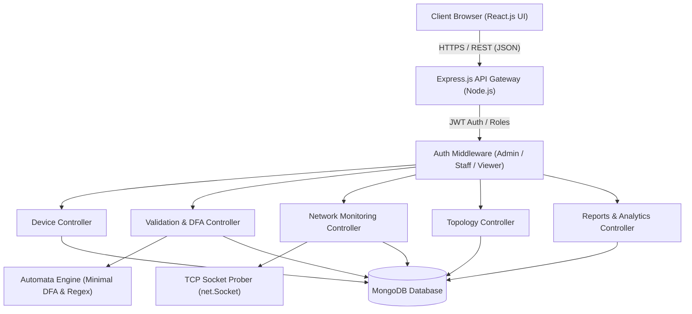

# NetTrack DFA — System Architecture

## 1. Multi-Tier Layered Architecture
NetTrack DFA is built upon an enterprise multi-tier architecture consisting of:
1. **Presentation Tier (Frontend):** React.js single-page application (SPA) created with Vite, leveraging React Router v6, Chart.js for data visualization, and Lucide React icons.
2. **Application Tier (Backend API):** Node.js and Express.js RESTful service implementing modular controllers, JWT authentication middleware, rate limiting, and the FLAT Automata Engine.
3. **Data Tier (Persistence):** MongoDB document database accessed via Mongoose ODM, maintaining collections for users, devices, scopes, connections, validation history, and connectivity logs.

---

## 2. FLAT Automata Engine Architecture
The automata engine operates as an independent, deterministic state-machine subsystem:
1. **Alphabet Definition:** $\Sigma = \{0, 1, 2, 3, 4, 5, 6, 7, 8, 9, .\} \cup \{\text{OTHER}\}$
2. **Canonical Regular Expression:**
   `^(?:(?:25[0-5]|2[0-4][0-9]|1[0-9]{2}|[1-9]?[0-9])\.){3}(?:25[0-5]|2[0-4][0-9]|1[0-9]{2}|[1-9]?[0-9])$`
3. **Formal State Machine (5-Tuple):** $M = (Q, \Sigma, \delta, q_0, F)$
   - $Q$: Finite set of states spanning 4 octet validation stages plus `TRAP_DEAD`.
   - $\delta(q, a) \to q'$: Deterministic transition table.
   - $q_0 = \text{S\_1}$: Start of Octet 1.
   - $F$: Subset of accepting terminal configurations of the 4th octet.
   - Sink State: `TRAP_DEAD` traps all invalid transitions.

---

## 3. Network Monitoring Subsystem
1. **Socket Prober:** Non-destructive TCP probe connects to standard port 80 / 53 with strict 2000ms timeout.
2. **Status Inference:**
   - Socket connects successfully $\to$ **Online** (Latency recorded in ms).
   - Remote host responds with TCP RST (`ECONNREFUSED`) $\to$ **Online** (TCP stack is alive).
   - Timeout (`ETIMEDOUT`) or Host Unreachable (`EHOSTUNREACH`) $\to$ **Offline**.
3. **Cloud Awareness:** In public cloud deployments (Render/Vercel), detects non-routable private RFC 1918 addresses and returns an honest architectural notice rather than false telemetry.
